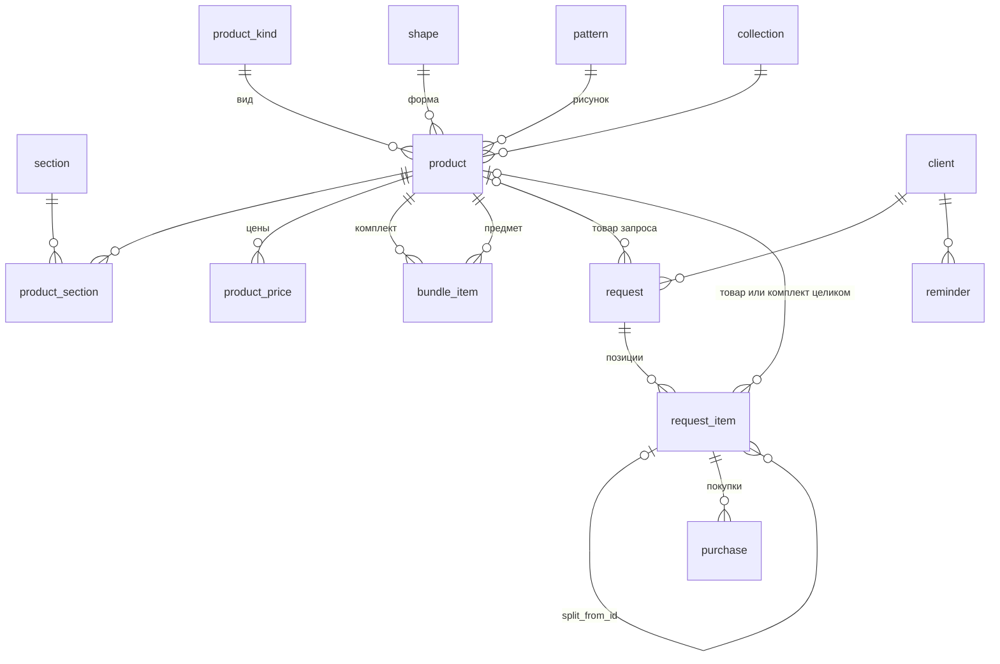

# Схема базы данных: сервизы по частям

**Версия схемы 5 от 13.11.2026, соответствует [ТЗ](TZ.md) версии 1.14.** Что менялось — в разделе 8 «История версий». Копия документа «Схема базы данных» с claude.ai; SQL лежит отдельными файлами в [sql/](sql/).

## 1. Принципы и допущения

Схема построена по файлу товаров ipm\_stolovye\_chayno-kofeynye\_servizy3.xlsx (1977 товаров, 864 комплекта с составом, данные на 03–05.11.2026). Схема записана для SQLite. В PWA на IndexedDB те же таблицы становятся хранилищами с теми же полями и индексами.

**Принципы:**

- Обычные действия ничего не удаляют: клиенты и товары помечаются архивными, позиции и запросы закрываются или снимаются с ожидания. Удалить навсегда можно только то, что уже в архиве: клиента, запрос или снятую позицию — вместе со всем, что к ним относится (раздел 5).
- Деньги хранятся целым числом в копейках, даты в формате ISO («2026-11-03», со временем «2026-11-03 14:30»).
- Остаток по позиции не хранится. Он считается как нужное количество минус сумма покупок.
- Текущая цена товара — запись справочника цен с самой поздней датой начала действия, не позже сегодняшнего дня.
- Подбор идёт по предметам. Если пришёл комплект (например, «Чашка с блюдцем»), система раскладывает его на предметы и ищет тех, кому не хватает этих предметов, а также тех, кто ждёт этот комплект целиком (с версии 4).

**Что изменилось после сверки с файлом:**

- **Главный ключ — артикул.** В файле у каждого товара есть артикул, все 1977 уникальны. Названия остаются, но поиск и связи строятся по артикулу. В ТЗ это учтено с версии 1.2.
- **Комплект — это тоже товар.** В файле сервизы лежат в общем списке товаров со своим артикулом и ценой, а состав указан отдельно. Поэтому отдельной таблицы комплектов больше нет: комплект — это товар, у которого есть состав. Цена комплекта получила историю, как у остальных товаров.
- **Комплект может входить в сервиз через свои предметы.** «Чашка с блюдцем» (81.31631.00.1) сама состоит из чашки 80.44694.00.1 и блюдца 80.44695.00.1, а сервиз «Саламандра Грей» на 6 персон состоит из 6 таких же чашек и 6 таких же блюдец. Поэтому запрос хранит предметы, а поступивший комплект раскладывается на предметы при подборе.
- **Предметы, которых нет в продаже по отдельности.** Из 2659 строк состава только 280 ссылаются на товары из списка, у 1358 строк нет артикула вовсе. Такие предметы создаются как товары с отметкой «только в составе», чтобы на них можно было оформить запрос.
- **Упаковка.** В составе встречаются «Подарочная упаковка», «Коробка», «Буклет». Они хранятся с отметкой «упаковка» и не попадают в запросы клиентов.
- **Новые поля товара:** раздел (их может быть несколько), подраздел, коллекция, материал, вес, год начала выпуска, число персон и предметов, наличие на сайте, ссылки на страницу и фото, габариты предмета.
- **Раздел вместо группы.** Группы из ТЗ заменены разделами из файла: «Столовые предметы», «Чайно-кофейные предметы», «Сервизы». Товар может входить в несколько разделов. Разделы «Приборы» и «Емкости для хранения» в файле не встречаются, но их можно добавить.

**Допущения:**

- В состав комплекта входят только товары без состава (ТЗ 1.13), это проверяет база. В файле так собраны все комплекты, кроме двух сервизов «Идиллия» с рисунком «Астра» (81.32371.00.1 и 81.32396.00.1): в их составе указаны наборы «Чашка с блюдцем» 81.32372.00.1 и 81.32373.00.1. При загрузке такой набор заменяется своими предметами — чашкой и блюдцем в нужном количестве.
- Число персон и предметов хранится так, как указано в файле, потому что состав иногда неполный или включает упаковку.
- Наличие на сайте хранится только для справки: складской учёт по ТЗ не ведётся.

## 2. Диаграмма связей



Комплект хранится как обычный товар, а его состав — в отдельной таблице. Подбор выполняется по позиции запроса: она ссылается либо на предмет, либо на вид, форму и рисунок. Всего 15 таблиц, из них на схеме 14.

## 3. Таблицы

В каждой таблице первичный ключ `id` — целое число, которое присваивается автоматически. Ссылки на другие таблицы называются `<таблица>_id`. В скобках указана колонка файла, из которой берётся значение.

### 3.1. Справочники

| Таблица | Поля | Ограничения |
| --- | --- | --- |
| section | id, name, sort\_order | Раздел (колонка «Раздел»). name уникально. Начальные значения: Столовые предметы, Чайно-кофейные предметы, Сервизы |
| product\_section | product\_id, section\_id | Связь товара с разделами, у товара их может быть несколько. Ключ составной |
| product\_kind | id, name | Вид изделия («Вид изделия», для предметов из состава — «Предмет»). name уникально. Примеры: Тарелка, Чашка чайная, Блюдце |
| shape | id, name | Форма («Форма»). name уникально |
| pattern | id, name | Рисунок («Рисунок»). name уникально |
| collection | id, name | Коллекция («Коллекция»). name уникально |

### 3.2. Товары и цены

**product** — товар. Сюда же входят комплекты (у них есть строки в bundle\_item) и предметы из состава комплектов.

| Поле | Тип | Ограничения |
| --- | --- | --- |
| id | INTEGER | первичный ключ |
| article | TEXT | артикул («Артикул»), уникален. Может быть пустым у предметов из состава без артикула |
| name | TEXT | обязательно, название («Название») |
| kind\_id | INTEGER | ссылка на product\_kind, может быть пустым |
| shape\_id | INTEGER | ссылка на shape, может быть пустым (в файле не указано у 31 товара) |
| pattern\_id | INTEGER | ссылка на pattern, может быть пустым (не указано у 16) |
| collection\_id | INTEGER | ссылка на collection, может быть пустым |
| subsection | TEXT | подраздел («Подраздел»), для справки |
| material | TEXT | материал («Материал») |
| persons | INTEGER | число персон («Персон»), у комплектов |
| items\_count | INTEGER | число предметов («Предметов»), у комплектов |
| weight\_g | INTEGER | вес в граммах («Вес, г» или вес предмета из состава) |
| height\_mm, length\_mm, width\_mm, volume\_ml | INTEGER | габариты предмета из листа «Состав комплектов» |
| year\_start | INTEGER | год начала выпуска («Год начала выпуска») |
| sold\_separately | INTEGER | 1 — продаётся отдельно (есть в листе «Товары»), 0 — только в составе комплекта |
| is\_packaging | INTEGER | 1 — упаковка, буклет и т. п., в запросы не попадает |
| site\_status | TEXT | наличие на сайте («Наличие»), только для справки |
| url | TEXT | ссылка на товар («Ссылка на товар») |
| photo\_url | TEXT | ссылка на фото («Ссылка на фото»), показывается, когда есть интернет |
| source | TEXT | file (загружено из файла) или manual (внесено вручную) |
| is\_archived | INTEGER | 0 или 1, по умолчанию 0 |
| created\_at | TEXT | дата создания |

**product\_price** — справочник цен товара и комплекта

| Поле | Тип | Ограничения |
| --- | --- | --- |
| id | INTEGER | первичный ключ |
| product\_id | INTEGER | обязательно, ссылка на product |
| price\_kop | INTEGER | обязательно, не меньше 0, цена в копейках («Цена, руб.» × 100) |
| valid\_from | TEXT | обязательно, дата начала действия; при загрузке — дата файла. Пара (product\_id, valid\_from) уникальна |

### 3.3. Состав комплектов

**bundle\_item** — состав комплекта (лист «Состав комплектов»)

| Поле | Тип | Ограничения |
| --- | --- | --- |
| bundle\_id | INTEGER | ссылка на product — комплект («Артикул комплекта») |
| product\_id | INTEGER | ссылка на product — предмет («Артикул предмета», а если его нет, то созданный предмет) |
| quantity | INTEGER | не меньше 1 («Шт. в комплекте») |

Первичный ключ составной: (bundle\_id, product\_id). Комплект не может входить сам в себя. В состав входят только товары без состава: товар, у которого есть состав, не может стать предметом другого комплекта, а у предмета из чьего-то состава не может появиться свой состав (триггеры trg\_bundle\_item\_leaf\_insert и trg\_bundle\_item\_leaf\_update). Отдельного признака «комплект» у товара нет: комплект — это товар, у которого есть строки в bundle\_item.

### 3.4. Клиенты, запросы и покупки

**client** — клиент

| Поле | Тип | Ограничения |
| --- | --- | --- |
| id | INTEGER | первичный ключ |
| name | TEXT | обязательно |
| phone | TEXT | телефон, можно оставить пустым |
| note | TEXT | заметки |
| is\_archived | INTEGER | 0 или 1, по умолчанию 0 |
| created\_at | TEXT | дата создания |

**request** — запрос: на комплект или на товарную позицию

| Поле | Тип | Ограничения |
| --- | --- | --- |
| id | INTEGER | первичный ключ |
| client\_id | INTEGER | обязательно, ссылка на client; при удалении клиента навсегда удаляется вместе с ним |
| product\_id | INTEGER | ссылка на product — товар, на который запрос: комплект или товарная позиция. Пусто только у запроса из одной свободной позиции «что-то подобное» |
| status | TEXT | active (ждёт), closed (всё куплено) или withdrawn (снят с ожидания), по умолчанию active |
| withdraw\_reason | TEXT | причина, если весь запрос снят с ожидания |
| created\_at | TEXT | дата записи |
| closed\_at | TEXT | дата закрытия или снятия, пока запрос активен пусто |
| note | TEXT | заметка |

Запрос на комплект или на товар определяется по товару запроса: если у него есть состав, это запрос на комплект. У клиента может быть сколько угодно запросов на разные товары, общего запроса «Отдельные товары» нет (ТЗ 1.12). Название запроса — название его товара.

**request\_item** — позиция запроса: либо предмет из состава комплекта, либо свободная позиция «что-то подобное»

| Поле | Тип | Ограничения |
| --- | --- | --- |
| id | INTEGER | первичный ключ |
| request\_id | INTEGER | обязательно, ссылка на request; удаляется вместе с запросом |
| product\_id | INTEGER | ссылка на product — предмет или комплект целиком; пусто у свободной позиции |
| kind\_id | INTEGER | вид для свободной позиции, ссылка на product\_kind, иначе пусто |
| shape\_id | INTEGER | форма для свободной позиции, ссылка на shape, иначе пусто |
| pattern\_id | INTEGER | рисунок для свободной позиции, ссылка на pattern, иначе пусто |
| qty\_needed | INTEGER | сколько нужно всего; не меньше 1 и не меньше уже купленного. Меняется кнопкой «Изменить» |
| price\_kop | INTEGER | цена предмета из справочника на момент записи. Пусто у свободной позиции и у предмета без цены (продаётся только в составе) |
| status | TEXT | waiting (ждёт), bought (куплено всё), withdrawn (снято с ожидания) или split (разбито на состав), по умолчанию waiting |
| withdraw\_reason | TEXT | причина снятия: «купил в другом месте», «передумал», «уже есть» или своя |
| split\_from\_id | INTEGER | ссылка на позицию «комплект целиком», из которой эта позиция получена при «Разбить на состав»; пусто у остальных |
| created\_at | TEXT | дата записи, по ней строится очередь; «Изменить» её не меняет |
| updated\_at | TEXT | дата последнего изменения кнопкой «Изменить» |
| closed\_at | TEXT | дата закрытия или снятия, пока позиция ждёт пусто |
| note | TEXT | заметка |

Проверка: заполнен либо product\_id (а kind\_id, shape\_id, pattern\_id пусты), либо все три kind\_id, shape\_id и pattern\_id (а product\_id и price\_kop пусты). Упаковка в позиции запроса не попадает.

**purchase** — покупка по позиции, история частичных покупок

| Поле | Тип | Ограничения |
| --- | --- | --- |
| id | INTEGER | первичный ключ |
| request\_item\_id | INTEGER | обязательно, ссылка на request\_item; удаляется вместе с позицией |
| qty | INTEGER | не меньше 1, сколько куплено |
| purchased\_at | TEXT | обязательно, дата покупки |
| note | TEXT | заметка |

### 3.5. Напоминания и настройки

**reminder** — напоминание «позвонить»

| Поле | Тип | Ограничения |
| --- | --- | --- |
| id | INTEGER | первичный ключ |
| client\_id | INTEGER | обязательно, ссылка на client |
| request\_id | INTEGER | ссылка на request, можно пусто |
| request\_item\_id | INTEGER | ссылка на request\_item, можно пусто. Напоминание удаляется вместе с клиентом, запросом или позицией, к которым привязано |
| remind\_at | TEXT | обязательно, дата и время напоминания |
| note | TEXT | заметка |
| status | TEXT | waiting или done, по умолчанию waiting |
| done\_at | TEXT | когда выполнено, пока не выполнено пусто |
| created\_at | TEXT | дата создания |

**settings** — настройки приложения

| Поле | Тип | Ограничения |
| --- | --- | --- |
| key | TEXT | первичный ключ |
| value | TEXT | значение |

Используются ключи last\_backup\_at (дата последней резервной копии) и schema\_version (версия схемы для будущих обновлений).

## 4. Ключевые запросы

### 4.1. Подбор клиентов по товару

Главный сценарий: продавец выбирает пришедший товар (`:product_id`), и система показывает очередь по дате записи. Если пришёл комплект, он раскладывается на предметы без упаковки. Затем находятся клиенты, которым не хватает этих предметов, и клиенты со свободной позицией того же вида, формы и рисунка.

Запрос проверен на данных файла. Для сервиза «Саламандра Грей» поступившая «Чашка с блюдцем» находит клиентов, которым не хватает чашек и блюдец. Остаток учитывает частичные покупки, позиции «не нужно» не показываются.

```sql
WITH leaves AS (
  -- пришёл комплект: раскладываем на предметы, без упаковки
  SELECT bi.product_id AS leaf_id, bi.quantity AS qty_in_arrival
  FROM bundle_item bi
  JOIN product lp ON lp.id = bi.product_id AND lp.is_packaging = 0
  WHERE bi.bundle_id = :product_id
  UNION
  -- сам пришедший товар: предмет или комплект целиком
  SELECT :product_id, 1
),
leaf AS (
  SELECT l.leaf_id, l.qty_in_arrival, p.name, p.kind_id, p.shape_id, p.pattern_id
  FROM leaves l JOIN product p ON p.id = l.leaf_id
),
hits AS (
  SELECT ri.id AS ri_id, leaf.leaf_id, leaf.name AS item, leaf.qty_in_arrival, 0 AS whole_hint
  FROM request_item ri
  JOIN leaf ON ri.product_id = leaf.leaf_id
            OR (ri.product_id IS NULL AND ri.kind_id = leaf.kind_id
                AND ri.shape_id = leaf.shape_id AND ri.pattern_id = leaf.pattern_id)
  WHERE ri.status = 'waiting'
  UNION ALL
  -- подсказка: пришёл предмет комплекта (сам или в составе пришедшего),
  -- а клиент ждёт этот комплект целиком
  SELECT DISTINCT ri.id, ri.product_id, b.name, 1, 1
  FROM request_item ri
  JOIN bundle_item bi ON bi.bundle_id = ri.product_id
  JOIN leaf ON leaf.leaf_id = bi.product_id
  JOIN product b ON b.id = ri.product_id
  WHERE ri.status = 'waiting'
    AND ri.product_id NOT IN (SELECT leaf_id FROM leaf)
)
SELECT c.name AS client, c.phone, COALESCE(b.name, 'Что-то подобное') AS request_title,
       h.item, h.qty_in_arrival, h.whole_hint,
       ri.qty_needed - COALESCE((SELECT SUM(qty) FROM purchase
                                 WHERE request_item_id = ri.id), 0) AS remaining,
       ri.created_at, ri.price_kop AS price_at_signup,
       (SELECT pp.price_kop FROM product_price pp
         WHERE pp.product_id = :product_id AND pp.valid_from <= date('now')
         ORDER BY pp.valid_from DESC LIMIT 1) AS arrival_price_now
FROM hits h
JOIN request_item ri ON ri.id = h.ri_id
JOIN request r ON r.id = ri.request_id AND r.status = 'active'
JOIN client c ON c.id = r.client_id AND c.is_archived = 0
LEFT JOIN product b ON b.id = r.product_id
WHERE remaining > 0
ORDER BY h.whole_hint, ri.created_at;
```

С версии 4 запрос находит и позиции «комплект целиком»: пришёл комплект — ждущие его целиком клиенты попадают в список вместе с ждущими его предметы. Если пришёл предмет (или набор вроде «Чашка с блюдцем»), а клиент ждёт целиком комплект, в который этот предмет входит, строка выходит с whole\_hint = 1: это подсказка в конце списка «ждёт комплект целиком», по ней продавец может предложить клиенту разбить комплект на состав.

### 4.2. Что ещё ждёт клиент по запросу

```sql
SELECT COALESCE(p.name, k.name || ', ' || s.name || ', ' || pt.name) AS item,
       ri.qty_needed - COALESCE(SUM(pu.qty), 0) AS remaining
FROM request_item ri
LEFT JOIN product p ON p.id = ri.product_id
LEFT JOIN product_kind k ON k.id = ri.kind_id
LEFT JOIN shape s ON s.id = ri.shape_id
LEFT JOIN pattern pt ON pt.id = ri.pattern_id
LEFT JOIN purchase pu ON pu.request_item_id = ri.id
WHERE ri.request_id = :request_id AND ri.status = 'waiting'
GROUP BY ri.id;
```

### 4.3. Текущая цена товара

```sql
SELECT price_kop FROM product_price
WHERE product_id = :product_id AND valid_from <= date('now')
ORDER BY valid_from DESC LIMIT 1;
```

### 4.4. Напоминания на сегодня и просроченные

```sql
SELECT r.id, c.name, c.phone, r.remind_at, r.note
FROM reminder r JOIN client c ON c.id = r.client_id
WHERE r.status = 'waiting' AND r.remind_at <= date('now', 'localtime') || ' 23:59'
ORDER BY r.remind_at;
```

### 4.5. Что исчезнет при удалении клиента навсегда

Эти цифры показываются в окне подтверждения.

```sql
SELECT
  (SELECT count(*) FROM request WHERE client_id = :client_id) AS requests,
  (SELECT count(*) FROM request_item ri JOIN request r ON r.id = ri.request_id
    WHERE r.client_id = :client_id) AS items,
  (SELECT count(*) FROM purchase pu JOIN request_item ri ON ri.id = pu.request_item_id
    JOIN request r ON r.id = ri.request_id WHERE r.client_id = :client_id) AS purchases,
  (SELECT count(*) FROM reminder WHERE client_id = :client_id) AS reminders;
```

### 4.6. Разбить на состав

Позиция «комплект целиком» превращается в позиции по его предметам (без упаковки). Количество = количество предмета в комплекте × сколько комплектов ещё ждёт клиент. Дата записи остаётся прежней, поэтому очередь не меняется. Цена при записи — цена предмета на дату записи, а если на ту дату цены нет — первая известная. Исходная позиция получает статус split и уходит в архив запроса. Всё выполняется одной транзакцией.

```sql
-- 1. Новые позиции: предметы комплекта × сколько комплектов ещё ждёт клиент
INSERT INTO request_item (request_id, product_id, qty_needed, price_kop, created_at, split_from_id)
SELECT ri.request_id, bi.product_id,
       bi.quantity * (ri.qty_needed - COALESCE((SELECT SUM(qty) FROM purchase
                                                WHERE request_item_id = ri.id), 0)),
       COALESCE(
         (SELECT pp.price_kop FROM product_price pp      -- цена на дату записи
           WHERE pp.product_id = bi.product_id AND pp.valid_from <= date(ri.created_at)
           ORDER BY pp.valid_from DESC LIMIT 1),
         (SELECT pp.price_kop FROM product_price pp      -- или первая известная
           WHERE pp.product_id = bi.product_id
           ORDER BY pp.valid_from LIMIT 1)),
       ri.created_at, ri.id
FROM request_item ri
JOIN bundle_item bi ON bi.bundle_id = ri.product_id
JOIN product p ON p.id = bi.product_id AND p.is_packaging = 0
WHERE ri.id = :item_id AND ri.status = 'waiting';

-- 2. Исходная позиция уходит в архив запроса
UPDATE request_item
SET status = 'split', closed_at = datetime('now', 'localtime')
WHERE id = :item_id;
```

Предметы, которые клиент отметил в окне «Разбить на состав» как «уже есть», приложение в той же транзакции снимает с ожидания с причиной «уже есть». Запрос проверен на данных файла: чайный сервиз на 6 персон раскладывается на сахарницу, чайник, 6 чашек и 6 блюдец с датой исходной записи, а попытка разбить не комплект отклоняется базой.

## 5. Правила целостности и работа приложения с данными

База проверяет форму данных, а последовательность действий обеспечивает приложение. Каждое из действий ниже выполняется одной транзакцией, чтобы не остаться с половиной изменений.

- **Запрос на комплект.** Для выбранного комплекта в request\_item копируется каждая строка состава bundle\_item, кроме упаковки: предмет, количество в qty\_needed, цена предмета из справочника на этот день в price\_kop (если у предмета есть цена), дата записи в created\_at. То, что у клиента уже есть, сразу снимается с ожидания с причиной «уже есть».
- **Запись на товар из «Товаров».** По умолчанию создаётся новый запрос с product\_id = этот товар. Если это предмет, в запросе одна позиция — сам предмет. Если комплект — позиции как у запроса на комплект: «Целиком» (одна позиция — комплект) или «По частям» (предметы состава). Продавец может вместо этого добавить позицию в уже существующий запрос клиента на этот же комплект или на комплект, к которому товар подходит по форме и рисунку.
- **Свободная позиция.** Создаётся с kind\_id, shape\_id и pattern\_id, без предмета и цены.
- **Подбор.** Поступивший комплект раскладывается на предметы (раздел 4.1), поэтому «Чашка с блюдцем» находит тех, кому не хватает чашек и блюдец, в том числе тех, кто ждёт отдельно чашку или блюдце.
- **«Купил».** В purchase добавляется строка с количеством и датой. Если сумма покупок по позиции достигла qty\_needed, позиция получает статус bought и дату закрытия. Если куплен комплект «Чашка с блюдцем», покупка записывается в обе позиции: чашку и блюдце.
- **«Изменить».** Меняются только qty\_needed, note и updated\_at. Триггер не даёт сделать qty\_needed меньше суммы покупок. Цена и created\_at не меняются, поэтому место в очереди сохраняется.
- «Разбить на состав» — только у ждущей позиции «комплект целиком» (триггер trg\_split\_only\_waiting\_bundle). Новые позиции ссылаются на исходную через split\_from\_id и наследуют её дату записи.
- **«Снять с ожидания».** Позиция получает статус withdrawn, причину и дату закрытия. Покупки по ней остаются. Снять можно и весь запрос: его ждущие позиции снимаются с той же причиной.
- **«Вернуть в ожидание».** Статус снова waiting, причина и дата закрытия очищаются. created\_at и цена прежние.
- **Закрытие запроса.** Когда у запроса не осталось позиций в статусе waiting и хотя бы одна куплена, он получает статус closed и дату закрытия.
- **Изменение состава комплекта.** Уже созданные запросы не меняются: их позиции были скопированы при создании.
- **Новая цена.** В product\_price добавляется строка с новой датой начала действия. Цены в уже созданных позициях не меняются.
- **Архив.** Клиентов и товары помечают is\_archived = 1. Архивные товары не предлагаются при создании новых запросов, архивные клиенты не попадают в подбор.
- **Удалить навсегда.** Работает каскадом (`ON DELETE CASCADE`): удаление клиента убирает его запросы, позиции, покупки и напоминания; удаление запроса — его позиции, покупки и напоминания; удаление позиции — её покупки и напоминания. Триггеры разрешают удалить клиента только из архива, а запрос и позицию — только снятые с ожидания или закрытые. Товары, комплекты и цены удаление клиента не затрагивает. Перед удалением приложение показывает, что исчезнет (раздел 4.5).
- **Ссылки.** Включена проверка внешних ключей (`PRAGMA foreign_keys = ON`). Товар, на который ссылаются запросы или комплекты, удалить нельзя.
- **Индексы.** По `bundle_item(product_id)` и `product(kind_id, shape_id, pattern_id)` для разложения комплектов, по `request_item(product_id)` и `request_item(kind_id, shape_id, pattern_id)` для подбора, по `reminder(remind_at)`, `product_price(product_id, valid_from)`, `product(name)` и `client(name)` для поиска. По request(product\_id) — чтобы найти запросы клиентов на этот товар.

## 6. SQL для создания базы

Полный скрипт для SQLite, версия 5. Проверен загрузкой файла товаров и сценариями: правка количества ниже купленного и удаление клиента не из архива блокируются, комплект в составе другого комплекта не добавляется, удаление архивного клиента убирает его запросы, позиции, покупки и напоминания, а товары остаются; «Разбить на состав» не комплекта или не ждущей позиции блокируется. Состав комплекта (минимум два предмета или один предмет в количестве больше 1) проверяет приложение, а не база.

```sql
PRAGMA foreign_keys = ON;

CREATE TABLE section (
  id INTEGER PRIMARY KEY AUTOINCREMENT,
  name TEXT NOT NULL UNIQUE,
  sort_order INTEGER NOT NULL DEFAULT 0
);

CREATE TABLE product_kind (
  id INTEGER PRIMARY KEY AUTOINCREMENT,
  name TEXT NOT NULL UNIQUE
);

CREATE TABLE shape (
  id INTEGER PRIMARY KEY AUTOINCREMENT,
  name TEXT NOT NULL UNIQUE
);

CREATE TABLE pattern (
  id INTEGER PRIMARY KEY AUTOINCREMENT,
  name TEXT NOT NULL UNIQUE
);

CREATE TABLE collection (
  id INTEGER PRIMARY KEY AUTOINCREMENT,
  name TEXT NOT NULL UNIQUE
);

CREATE TABLE product (
  id INTEGER PRIMARY KEY AUTOINCREMENT,
  article TEXT UNIQUE,
  name TEXT NOT NULL,
  kind_id INTEGER REFERENCES product_kind(id),
  shape_id INTEGER REFERENCES shape(id),
  pattern_id INTEGER REFERENCES pattern(id),
  collection_id INTEGER REFERENCES collection(id),
  subsection TEXT,
  material TEXT,
  persons INTEGER CHECK (persons >= 1),
  items_count INTEGER CHECK (items_count >= 1),
  weight_g INTEGER CHECK (weight_g >= 0),
  height_mm INTEGER,
  length_mm INTEGER,
  width_mm INTEGER,
  volume_ml INTEGER,
  year_start INTEGER,
  sold_separately INTEGER NOT NULL DEFAULT 1 CHECK (sold_separately IN (0, 1)),
  is_packaging INTEGER NOT NULL DEFAULT 0 CHECK (is_packaging IN (0, 1)),
  site_status TEXT,
  url TEXT,
  photo_url TEXT,
  source TEXT NOT NULL DEFAULT 'manual' CHECK (source IN ('file', 'manual')),
  is_archived INTEGER NOT NULL DEFAULT 0 CHECK (is_archived IN (0, 1)),
  created_at TEXT NOT NULL DEFAULT (datetime('now', 'localtime'))
);

CREATE TABLE product_section (
  product_id INTEGER NOT NULL REFERENCES product(id),
  section_id INTEGER NOT NULL REFERENCES section(id),
  PRIMARY KEY (product_id, section_id)
);

CREATE TABLE product_price (
  id INTEGER PRIMARY KEY AUTOINCREMENT,
  product_id INTEGER NOT NULL REFERENCES product(id),
  price_kop INTEGER NOT NULL CHECK (price_kop >= 0),
  valid_from TEXT NOT NULL,
  UNIQUE (product_id, valid_from)
);

CREATE TABLE bundle_item (
  bundle_id INTEGER NOT NULL REFERENCES product(id),
  product_id INTEGER NOT NULL REFERENCES product(id),
  quantity INTEGER NOT NULL CHECK (quantity >= 1),
  PRIMARY KEY (bundle_id, product_id),
  CHECK (bundle_id <> product_id)
);

CREATE TABLE client (
  id INTEGER PRIMARY KEY AUTOINCREMENT,
  name TEXT NOT NULL,
  phone TEXT,
  note TEXT,
  is_archived INTEGER NOT NULL DEFAULT 0 CHECK (is_archived IN (0, 1)),
  created_at TEXT NOT NULL DEFAULT (datetime('now', 'localtime'))
);

CREATE TABLE request (
  id INTEGER PRIMARY KEY AUTOINCREMENT,
  client_id INTEGER NOT NULL REFERENCES client(id) ON DELETE CASCADE,
  product_id INTEGER REFERENCES product(id),
  status TEXT NOT NULL DEFAULT 'active' CHECK (status IN ('active', 'closed', 'withdrawn')),
  withdraw_reason TEXT,
  created_at TEXT NOT NULL DEFAULT (datetime('now', 'localtime')),
  closed_at TEXT,
  note TEXT
);

CREATE TABLE request_item (
  id INTEGER PRIMARY KEY AUTOINCREMENT,
  request_id INTEGER NOT NULL REFERENCES request(id) ON DELETE CASCADE,
  product_id INTEGER REFERENCES product(id),
  kind_id INTEGER REFERENCES product_kind(id),
  shape_id INTEGER REFERENCES shape(id),
  pattern_id INTEGER REFERENCES pattern(id),
  qty_needed INTEGER NOT NULL CHECK (qty_needed >= 1),
  price_kop INTEGER CHECK (price_kop >= 0),
  status TEXT NOT NULL DEFAULT 'waiting' CHECK (status IN ('waiting', 'bought', 'withdrawn', 'split')),
  withdraw_reason TEXT,
  created_at TEXT NOT NULL DEFAULT (datetime('now', 'localtime')),
  updated_at TEXT,
  split_from_id INTEGER REFERENCES request_item(id) ON DELETE SET NULL,
  closed_at TEXT,
  note TEXT,
  CHECK (
    (product_id IS NOT NULL AND kind_id IS NULL AND shape_id IS NULL AND pattern_id IS NULL)
    OR
    (product_id IS NULL AND price_kop IS NULL
     AND kind_id IS NOT NULL AND shape_id IS NOT NULL AND pattern_id IS NOT NULL)
  )
);

CREATE TABLE purchase (
  id INTEGER PRIMARY KEY AUTOINCREMENT,
  request_item_id INTEGER NOT NULL REFERENCES request_item(id) ON DELETE CASCADE,
  qty INTEGER NOT NULL CHECK (qty >= 1),
  purchased_at TEXT NOT NULL,
  note TEXT
);

CREATE TABLE reminder (
  id INTEGER PRIMARY KEY AUTOINCREMENT,
  client_id INTEGER NOT NULL REFERENCES client(id) ON DELETE CASCADE,
  request_id INTEGER REFERENCES request(id) ON DELETE CASCADE,
  request_item_id INTEGER REFERENCES request_item(id) ON DELETE CASCADE,
  remind_at TEXT NOT NULL,
  note TEXT,
  status TEXT NOT NULL DEFAULT 'waiting' CHECK (status IN ('waiting', 'done')),
  done_at TEXT,
  created_at TEXT NOT NULL DEFAULT (datetime('now', 'localtime'))
);

CREATE TABLE settings (
  key TEXT PRIMARY KEY,
  value TEXT
);

CREATE INDEX idx_product_name ON product(name);
CREATE INDEX idx_product_match ON product(kind_id, shape_id, pattern_id);
CREATE INDEX idx_bundle_item_product ON bundle_item(product_id);
CREATE INDEX idx_request_item_product ON request_item(product_id);
CREATE INDEX idx_request_item_match ON request_item(kind_id, shape_id, pattern_id);
CREATE INDEX idx_request_item_request ON request_item(request_id);
CREATE INDEX idx_request_item_split ON request_item(split_from_id);
CREATE INDEX idx_purchase_item ON purchase(request_item_id);
CREATE INDEX idx_reminder_at ON reminder(remind_at);
CREATE INDEX idx_price_lookup ON product_price(product_id, valid_from);
CREATE INDEX idx_client_name ON client(name);

CREATE INDEX idx_request_product ON request(product_id);

-- В состав комплекта входят только товары без состава: вложенных комплектов нет
CREATE TRIGGER trg_bundle_item_leaf_insert
BEFORE INSERT ON bundle_item
WHEN EXISTS (SELECT 1 FROM bundle_item WHERE bundle_id = NEW.product_id)
  OR EXISTS (SELECT 1 FROM bundle_item WHERE product_id = NEW.bundle_id)
BEGIN
  SELECT RAISE(ABORT, 'В состав комплекта входят только товары без состава');
END;

CREATE TRIGGER trg_bundle_item_leaf_update
BEFORE UPDATE OF bundle_id, product_id ON bundle_item
WHEN EXISTS (SELECT 1 FROM bundle_item WHERE bundle_id = NEW.product_id)
  OR EXISTS (SELECT 1 FROM bundle_item WHERE product_id = NEW.bundle_id)
BEGIN
  SELECT RAISE(ABORT, 'В состав комплекта входят только товары без состава');
END;

-- «Изменить»: нужное количество не меньше уже купленного
CREATE TRIGGER trg_qty_not_below_bought
BEFORE UPDATE OF qty_needed ON request_item
WHEN NEW.qty_needed < (SELECT COALESCE(SUM(qty), 0) FROM purchase WHERE request_item_id = NEW.id)
BEGIN
  SELECT RAISE(ABORT, 'Нужно не может быть меньше уже купленного');
END;

-- «Разбить на состав» только у ждущей позиции, у которой товар — комплект
CREATE TRIGGER trg_split_only_waiting_bundle
BEFORE UPDATE OF status ON request_item
WHEN NEW.status = 'split' AND (OLD.status <> 'waiting'
  OR NOT EXISTS (SELECT 1 FROM bundle_item WHERE bundle_id = OLD.product_id))
BEGIN
  SELECT RAISE(ABORT, 'Разбить на состав можно только ждущий комплект целиком');
END;

-- «Удалить навсегда» только из архива
CREATE TRIGGER trg_delete_client_only_archived
BEFORE DELETE ON client WHEN OLD.is_archived = 0
BEGIN
  SELECT RAISE(ABORT, 'Сначала перенесите клиента в архив');
END;

CREATE TRIGGER trg_delete_request_only_archived
BEFORE DELETE ON request
WHEN OLD.status = 'active' AND (SELECT is_archived FROM client WHERE id = OLD.client_id) = 0
BEGIN
  SELECT RAISE(ABORT, 'Сначала снимите запрос с ожидания');
END;

CREATE TRIGGER trg_delete_item_only_archived
BEFORE DELETE ON request_item
WHEN OLD.status = 'waiting'
  AND (SELECT status FROM request WHERE id = OLD.request_id) = 'active'
  AND (SELECT c.is_archived FROM request r JOIN client c ON c.id = r.client_id WHERE r.id = OLD.request_id) = 0
BEGIN
  SELECT RAISE(ABORT, 'Сначала снимите позицию с ожидания');
END;

INSERT INTO section (name, sort_order) VALUES
  ('Столовые предметы', 1), ('Чайно-кофейные предметы', 2), ('Сервизы', 3);
INSERT INTO settings (key, value) VALUES ('schema_version', '5');
```

**Переход со схемы 4.** Скрипт выполняется один раз при обновлении базы. Каждая позиция запроса «Отдельные товары» становится своим запросом на этот товар; позиции, полученные «Разбить на состав», остаются вместе с исходной позицией. Даты записи, цены, покупки и место в очереди не меняются: они хранятся в позициях. Напоминания, привязанные к запросу «Отдельные товары», остаются у клиента. Вложенные наборы в составе комплектов раскладываются на предметы. Скрипт проверен на тестовой базе версии 4: проверка внешних ключей проходит, таблица запросов, индексы и триггеры совпадают со скриптом версии 5.

```sql
-- Переход со схемы 4 на схему 5 (ТЗ 1.12): запроса «Отдельные товары» больше нет.
-- Каждая позиция запроса «Отдельные товары» становится своим запросом на этот товар.
-- Позиции, полученные «Разбить на состав», идут в запрос своей исходной позиции.
-- Даты записи, цены, покупки и место в очереди не меняются: они хранятся в позициях.
-- Выполняется одной транзакцией при выключенной проверке внешних ключей.
PRAGMA foreign_keys = OFF;
BEGIN;

-- 0. Вложенные комплекты (например, «Чашка с блюдцем» в составе сервиза) раскладываются на предметы:
--    в составе остаются только товары без состава
INSERT INTO bundle_item (bundle_id, product_id, quantity)
SELECT o.bundle_id, i.product_id, o.quantity * i.quantity
FROM bundle_item o JOIN bundle_item i ON i.bundle_id = o.product_id
WHERE true
ON CONFLICT (bundle_id, product_id) DO UPDATE SET quantity = quantity + excluded.quantity;
DELETE FROM bundle_item WHERE product_id IN (SELECT bundle_id FROM bundle_item);

-- 1. Какие позиции куда переезжают: группа = исходная позиция и полученные из неё разбиением
CREATE TEMP TABLE mv AS
SELECT ri.id AS item_id,
       COALESCE(ri.split_from_id, ri.id) AS grp
FROM request_item ri
JOIN request r ON r.id = ri.request_id
WHERE r.kind = 'loose';

CREATE TEMP TABLE grp AS
SELECT g.grp,
       (SELECT MAX(id) FROM request) + ROW_NUMBER() OVER (ORDER BY g.grp) AS new_id,
       r.client_id,
       gi.product_id,                                   -- товар исходной позиции (пусто у «что-то подобное»)
       CASE
         WHEN r.status = 'withdrawn' THEN 'withdrawn'
         WHEN SUM(ri.status = 'waiting') > 0 THEN 'active'
         WHEN SUM(ri.status = 'bought') > 0 THEN 'closed'
         ELSE 'withdrawn'
       END AS status,
       CASE WHEN r.status = 'withdrawn' THEN r.withdraw_reason ELSE gi.withdraw_reason END AS withdraw_reason,
       gi.created_at,
       CASE WHEN r.status = 'withdrawn' THEN r.closed_at
            WHEN SUM(ri.status = 'waiting') > 0 THEN NULL
            ELSE MAX(ri.closed_at) END AS closed_at
FROM mv g
JOIN request_item ri ON ri.id = g.item_id
JOIN request_item gi ON gi.id = g.grp
JOIN request r ON r.id = ri.request_id
GROUP BY g.grp;

-- 2. Новая таблица запросов: товар запроса вместо kind и bundle_id
CREATE TABLE request_v5 (
  id INTEGER PRIMARY KEY AUTOINCREMENT,
  client_id INTEGER NOT NULL REFERENCES client(id) ON DELETE CASCADE,
  product_id INTEGER REFERENCES product(id),
  status TEXT NOT NULL DEFAULT 'active' CHECK (status IN ('active', 'closed', 'withdrawn')),
  withdraw_reason TEXT,
  created_at TEXT NOT NULL DEFAULT (datetime('now', 'localtime')),
  closed_at TEXT,
  note TEXT
);
INSERT INTO request_v5 (id, client_id, product_id, status, withdraw_reason, created_at, closed_at, note)
SELECT id, client_id, bundle_id, status, withdraw_reason, created_at, closed_at, note
FROM request WHERE kind = 'bundle';
INSERT INTO request_v5 (id, client_id, product_id, status, withdraw_reason, created_at, closed_at)
SELECT new_id, client_id, product_id, status, withdraw_reason, created_at, closed_at FROM grp;

-- 3. Позиции переезжают в новые запросы; напоминания к старому запросу остаются у клиента
UPDATE request_item
SET request_id = (SELECT grp.new_id FROM mv JOIN grp ON grp.grp = mv.grp WHERE mv.item_id = request_item.id)
WHERE id IN (SELECT item_id FROM mv);
UPDATE reminder SET request_id = NULL
WHERE request_id IN (SELECT id FROM request WHERE kind = 'loose');

-- 4. Замена таблицы (триггеры на request удаляются вместе со старой таблицей и создаются заново)
-- legacy_alter_table: триггеры позиций ссылаются на request, пока таблицы нет
PRAGMA legacy_alter_table = ON;
DROP TABLE request;
ALTER TABLE request_v5 RENAME TO request;
PRAGMA legacy_alter_table = OFF;
DROP INDEX IF EXISTS uq_loose_request;
CREATE INDEX idx_request_product ON request(product_id);

CREATE TRIGGER trg_delete_request_only_archived
BEFORE DELETE ON request
WHEN OLD.status = 'active' AND (SELECT is_archived FROM client WHERE id = OLD.client_id) = 0
BEGIN
  SELECT RAISE(ABORT, 'Сначала снимите запрос с ожидания');
END;

CREATE TRIGGER trg_bundle_item_leaf_insert
BEFORE INSERT ON bundle_item
WHEN EXISTS (SELECT 1 FROM bundle_item WHERE bundle_id = NEW.product_id)
  OR EXISTS (SELECT 1 FROM bundle_item WHERE product_id = NEW.bundle_id)
BEGIN
  SELECT RAISE(ABORT, 'В состав комплекта входят только товары без состава');
END;

CREATE TRIGGER trg_bundle_item_leaf_update
BEFORE UPDATE OF bundle_id, product_id ON bundle_item
WHEN EXISTS (SELECT 1 FROM bundle_item WHERE bundle_id = NEW.product_id)
  OR EXISTS (SELECT 1 FROM bundle_item WHERE product_id = NEW.bundle_id)
BEGIN
  SELECT RAISE(ABORT, 'В состав комплекта входят только товары без состава');
END;

UPDATE settings SET value = '5' WHERE key = 'schema_version';
DROP TABLE mv;
DROP TABLE grp;
COMMIT;
PRAGMA foreign_keys = ON;
PRAGMA foreign_key_check;
```

## 7. Загрузка из файла и замечания по данным

### 7.1. Порядок загрузки

1. **Лист «Товары».** Каждая строка с артикулом становится товаром с отметкой «продаётся отдельно». Пробелы по краям артикула убираются. Форма, рисунок, вид и коллекция заносятся в справочники, раздел разбивается по запятой. Цена записывается в справочник цен с датой файла (дата выгрузки, например 05.11.2026). Последняя строка с пояснением об источнике пропускается.
2. **Лист «Состав комплектов».** Служебные строки с заголовками («Артикул — Наименование…») и пустые строки пропускаются. Если артикул предмета есть среди товаров, используется этот товар. Если нет, создаётся предмет «только в составе» с формой и рисунком комплекта. Предметы без артикула объединяются по названию, форме и рисунку. Если в составе указан другой комплект (например, «Чашка с блюдцем» в сервизе), вместо него записываются его предметы, количество перемножается: в состав попадают только товары без состава.
3. **Упаковка.** Строки «Подарочная упаковка», «Коробка», «Буклет», «Шубер» получают отметку «упаковка».
4. **Повторная загрузка.** Товары сопоставляются по артикулу. Новые добавляются, у существующих обновляются поля, а при изменении цены в справочник добавляется новая запись. Ничего не удаляется.

Пробная загрузка файла ipm\_stolovye\_chayno-kofeynye\_servizy3.xlsx дала 1977 товаров в продаже, 1930 предметов «только в составе», 80 позиций упаковки и 860 комплектов (2630 строк состава). По сравнению с первым файлом добавилось 759 товаров (в основном чашки с блюдцем из раздела «Фарфоровые чашки»), ничего не пропало, цены прежних товаров не изменились.

### 7.2. Что нужно поправить в данных

| Что | Сколько | Как поступаем |
| --- | --- | --- |
| Комплект указан в составе самого себя (например, 81.10353.00.1, 80.05471.00.1) | 14 | Такие строки пропускаются |
| В составе сервиза указан другой комплект: «Чашка с блюдцем» 81.32372.00.1 и 81.32373.00.1 в сервизах «Идиллия» с рисунком «Астра» 81.32371.00.1 и 81.32396.00.1 | 4 строки в 2 комплектах | Вместо набора записываются его чашка и блюдце, количество перемножается |
| Артикул в названии не совпадает с колонкой «Артикул»: 80.98406.00.1, а в названии 80.86102.00.1 | 1 | Берётся колонка «Артикул», нужно проверить вручную |
| Пробел в конце артикула | 7 | Убирается при загрузке |
| Одна форма записана по-разному («Стандартная 2», «Стандартная-2», «Стандартная - 2» и т. п.) | 9 групп | Склеиваются без учёта регистра, пробелов и дефисов |
| Один рисунок записан по-разному («Сетка-Блюз 2», «Мамина дача» и т. п.) | 6 групп | Склеиваются так же |
| Названия предметов в составе не совпадают с видами («Чашка чайн. ф. Гербовая») | без правил 371 вид | По файлу «Соответствие\_видов\_v2.xlsx» их 87. Сокращения раскрыты; чашки определены по комплекту или по объёму (кофейные до 180 мл, чайные от 200 мл), блюдца по чашке, тарелки по высоте или диаметру, блюда по габаритам |
| Нет формы / рисунка / вида | 41 / 26 / 22 | Поля остаются пустыми, такие товары не подходят под свободные позиции |
| Строки состава без артикула предмета | 1358 | Предмет создаётся по названию |
| В составе есть не посуда: упаковка, буклеты, каталоги, флэшка с аудиокнигой | 80 позиций | Отмечаются как упаковка и в подбор не попадают |

Разделов «Приборы» и «Емкости для хранения» в файле нет. Емкости, видимо, лежат в «Столовых предметах» (например, «Банка с крышкой»).

## 8. История версий

Схема не менялась при переходе на новый файл: обновлены только цифры в разделах 1 и 7 и соответствие видов (10.11.2026).

| Версия | Дата | ТЗ | Что изменилось |
| --- | --- | --- | --- |
| 5 | 13.11.2026 | 1.13 | Запроса «Отдельные товары» больше нет: у запроса вместо kind и bundle\_id поле product\_id — товар, на который запрос (комплект или товарная позиция); убран уникальный индекс uq\_loose\_request. В состав комплекта входят только товары без состава (триггеры trg\_bundle\_item\_leaf\_insert и trg\_bundle\_item\_leaf\_update), вложенные наборы в файле раскладываются на предметы. Скрипт перехода со схемы 4 — в разделе 6 |
| 4 | 10.11.2026 | 1.8 | Комплект целиком в листе ожидания: статус позиции split, поле split\_from\_id, триггер trg\_split\_only\_waiting\_bundle; подбор (4.1) находит ждущих комплект целиком и даёт подсказку «ждёт целиком»; новый запрос 4.6 «Разбить на состав» |
| 3 | 10.11.2026 | 1.6 | Запрос «Отдельные товары» без комплекта (request.kind, bundle\_id может быть пустым). Статус позиции not\_needed заменён на withdrawn («снято с ожидания») с причиной; у запроса тоже есть статус withdrawn. Поле updated\_at и триггер для «Изменить». Удаление навсегда каскадом, только из архива. Запрос 4.5 для окна подтверждения |
| 2 | 03.11.2026 | 1.2 | Сверка с файлом с сайта: артикул как ключ, комплект — это товар с составом, предметы «только в составе», упаковка, разделы и коллекции, раскладка комплекта при подборе, загрузка из файла |
| 1 | 03.11.2026 | 1.1 | Первая версия схемы |
