# Эскизы экранов

**Соответствуют [ТЗ](../TZ.md) версии 1.10 от 12.11.2026.** Схема базы — [db-schema.md](../db-schema.md), версия 4.

Экран телефона 390×844. В папке три вида одних и тех же эскизов:

- `png/` — картинки, их видно прямо на GitHub;
- `*.html` — те же экраны как обычные страницы: открываются в браузере, ссылки между экранами работают;
- `src/` — исходники холста эскизов на claude.ai (`*.dc.html` и `canvas.json` с раскладкой). Их правят там и копируют сюда.

Что нового в 1.10: в нижнем меню четыре пункта — «Комплекты» вошли в «Товары». В «Товарах» переключатель «Все / Предметы / Комплекты» и кнопки «Добавить товар» и «Новый комплект» (1, 2, 2а, 10).

В 1.8: переключатель «По частям / Целиком» при записи на комплект (7, 16), позиция «комплект целиком» с кнопкой «Разбить на состав» (17, 18), подсказка «ждёт комплект целиком» в подборе (3).

| № | Экран | Картинка | Страница |
| --- | --- | --- | --- |
| 1 | Главная | [png](png/Main.png) | [html](Main.html) |
| 2 | Товары: поиск предметов и комплектов | [png](png/Search.png) | [html](Search.html) |
| 2а | Товары: фильтр «Комплекты» | [png](png/SearchSets.png) | [html](SearchSets.html) |
| 3 | Кто ждёт товар | [png](png/Queue.png) | [html](Queue.html) |
| 4 | После разговора | [png](png/AfterCall.png) | [html](AfterCall.html) |
| 5 | Карточка клиента | [png](png/Client.png) | [html](Client.html) |
| 6 | Запрос: купил, изменить, снять | [png](png/Request.png) | [html](Request.html) |
| 7 | Новый запрос: по частям | [png](png/NewRequest.png) | [html](NewRequest.html) |
| 8 | Товар: артикул, цены, состав | [png](png/Product.png) | [html](Product.html) |
| 9 | Комплект | [png](png/Set.png) | [html](Set.html) |
| 10 | Ещё: каталог, копия, справочники | [png](png/More.png) | [html](More.html) |
| 11 | Загрузка каталога из файла | [png](png/Import.png) | [html](Import.html) |
| 12 | Записать клиента на товар | [png](png/AddToList.png) | [html](AddToList.html) |
| 13 | Изменить позицию | [png](png/EditItem.png) | [html](EditItem.html) |
| 14 | Снять с ожидания | [png](png/RemoveItem.png) | [html](RemoveItem.html) |
| 15 | Клиент в архиве: удалить навсегда | [png](png/ArchivedClient.png) | [html](ArchivedClient.html) |
| 16 | Новый запрос: комплект целиком | [png](png/NewRequestWhole.png) | [html](NewRequestWhole.html) |
| 17 | Запрос: комплект целиком | [png](png/RequestWhole.png) | [html](RequestWhole.html) |
| 18 | Разбить на состав | [png](png/Split.png) | [html](Split.html) |

### 1. Главная

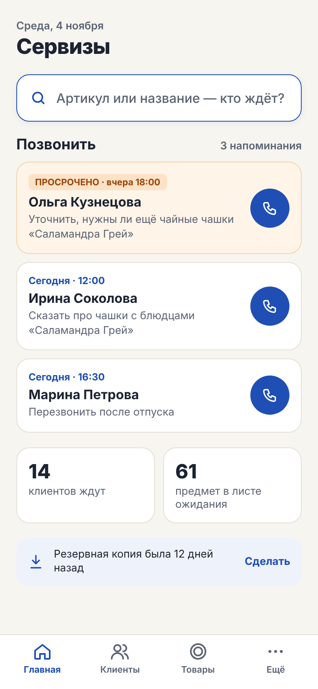

### 2. Товары: поиск предметов и комплектов

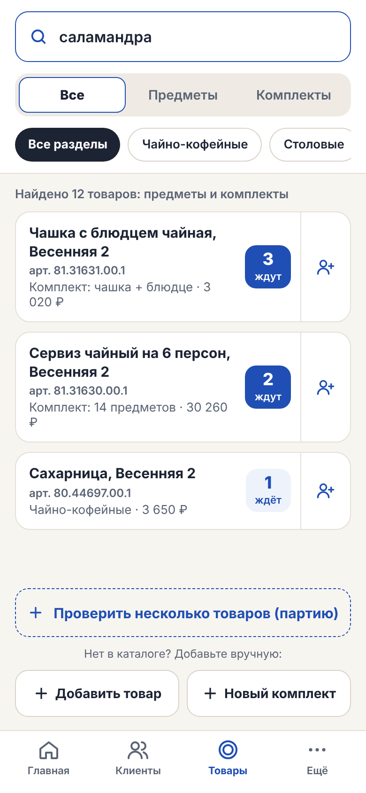

### 2а. Товары: фильтр «Комплекты»

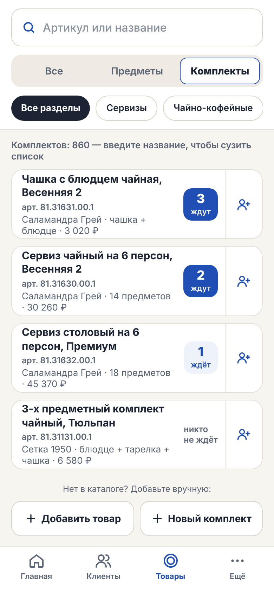

### 3. Кто ждёт товар

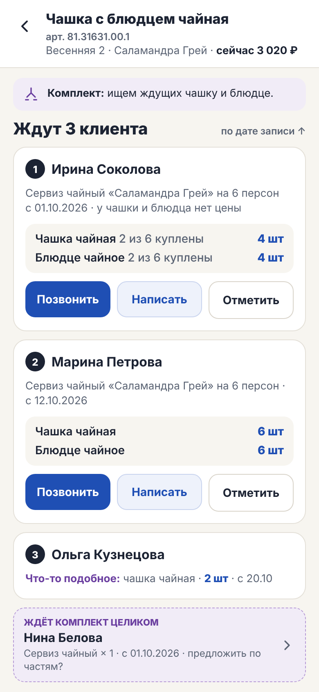

### 4. После разговора

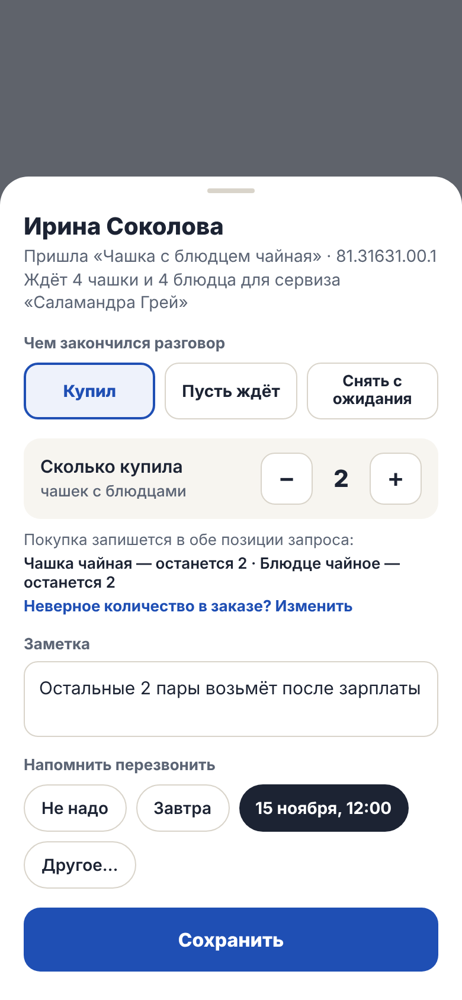

### 5. Карточка клиента

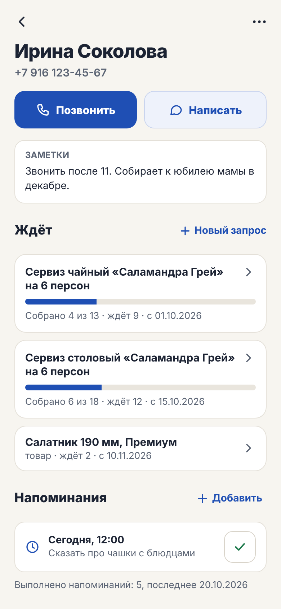

### 6. Запрос: купил, изменить, снять

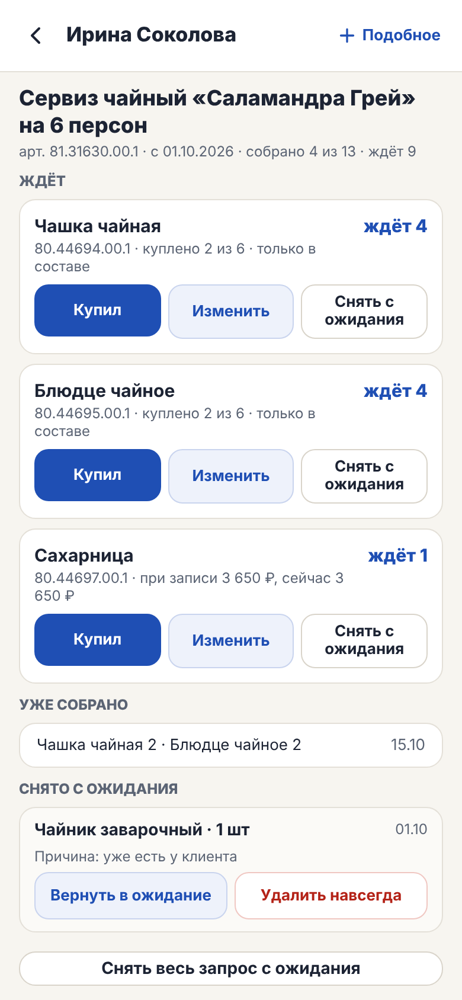

### 7. Новый запрос: по частям

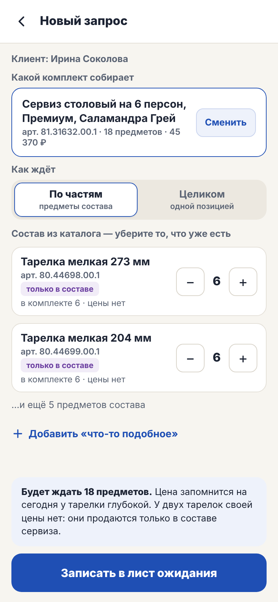

### 8. Товар: артикул, цены, состав

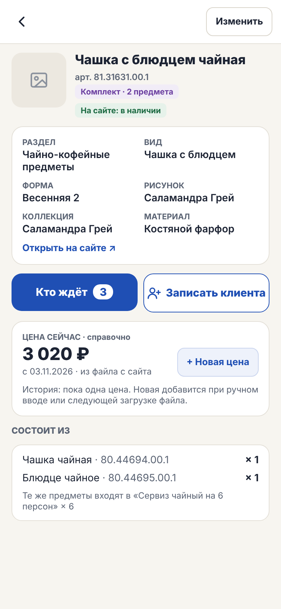

### 9. Комплект

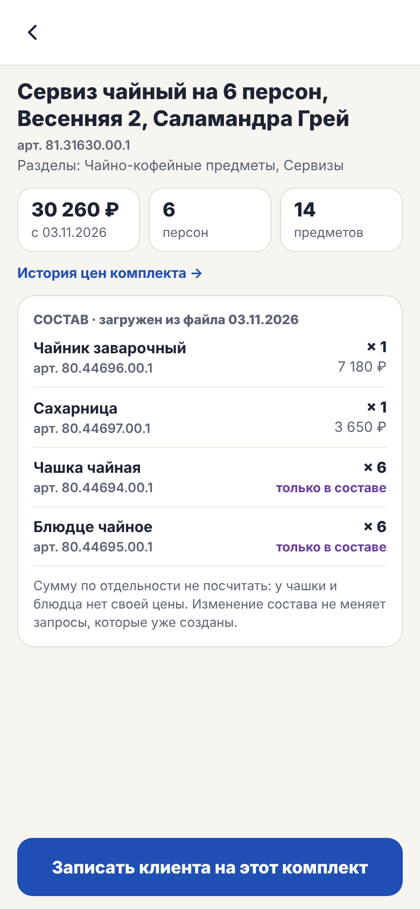

### 10. Ещё: каталог, копия, справочники

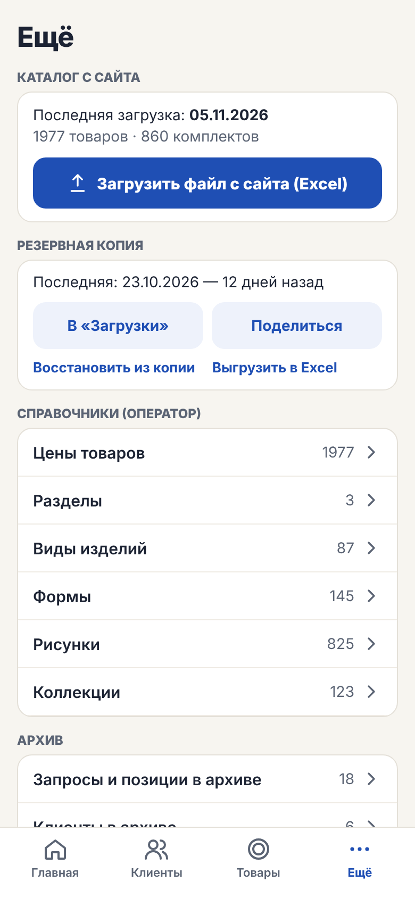

### 11. Загрузка каталога из файла

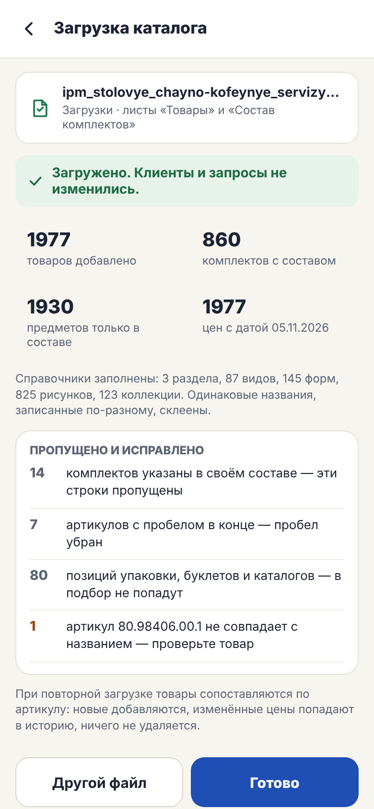

### 12. Записать клиента на товар

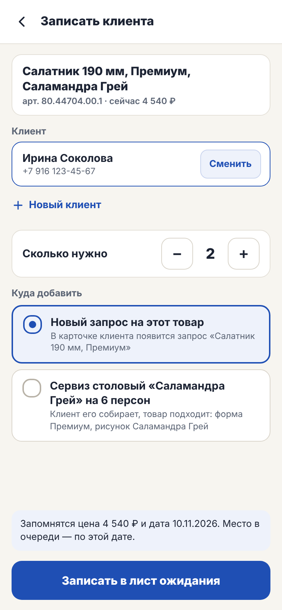

### 13. Изменить позицию

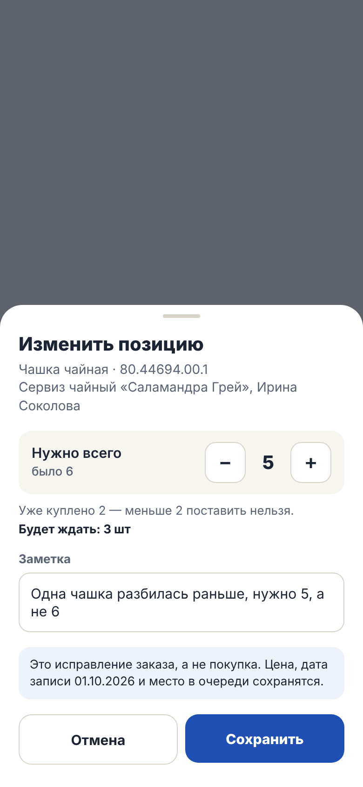

### 14. Снять с ожидания

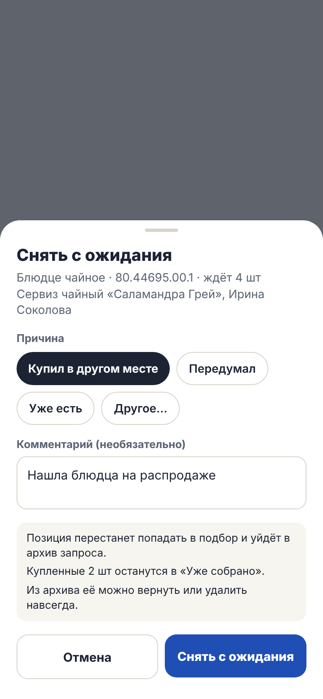

### 15. Клиент в архиве: удалить навсегда

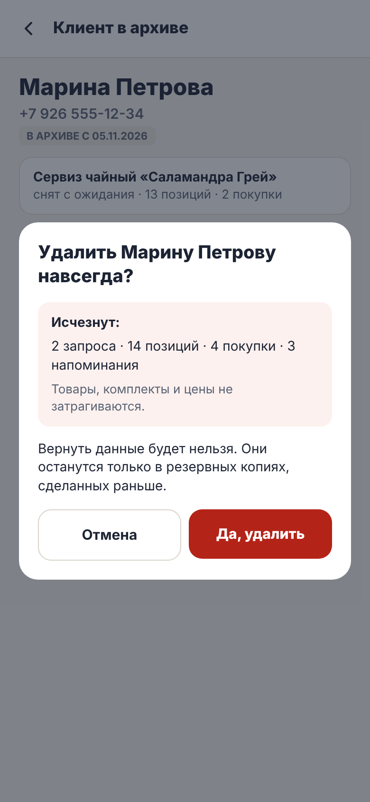

### 16. Новый запрос: комплект целиком

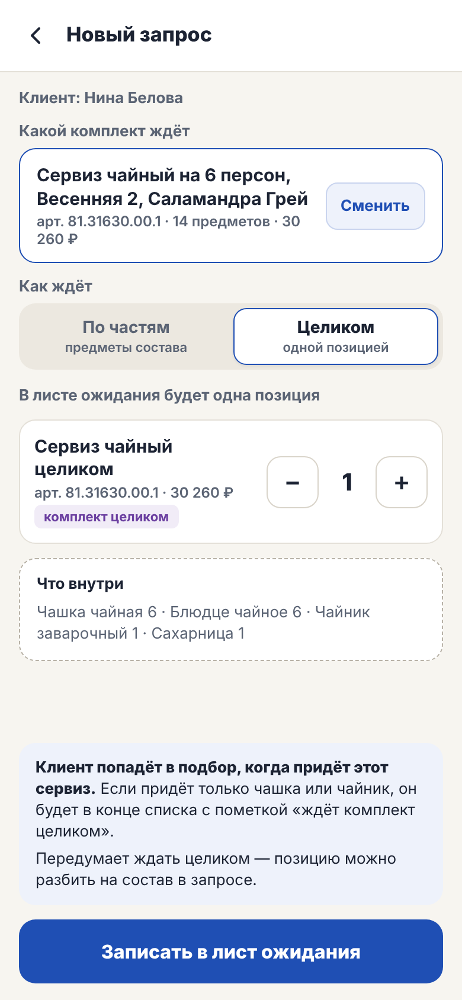

### 17. Запрос: комплект целиком

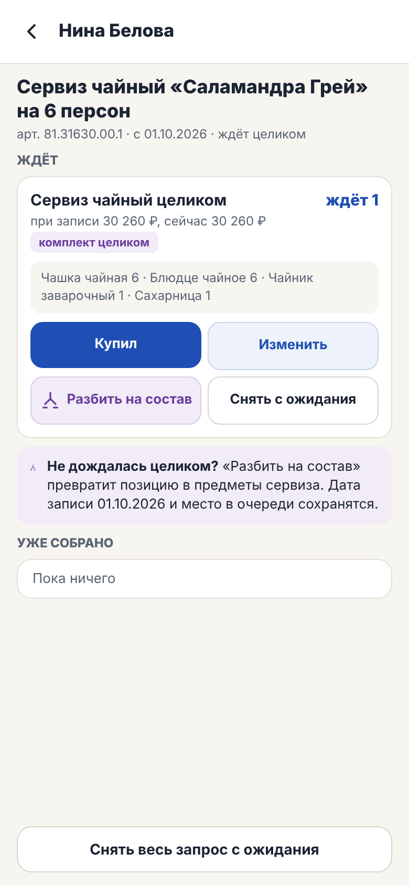

### 18. Разбить на состав

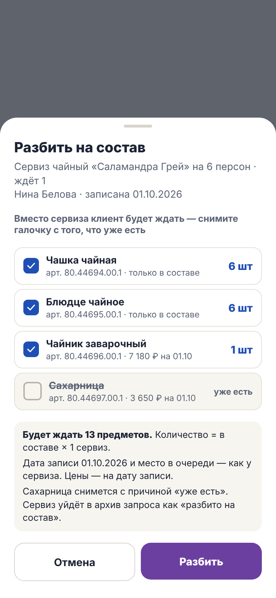
